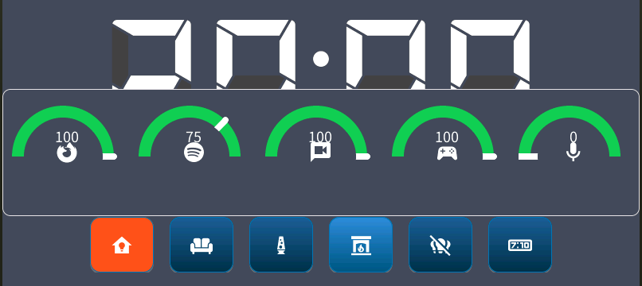
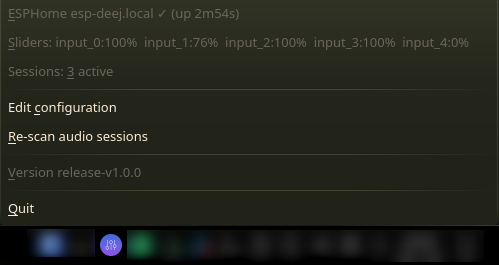
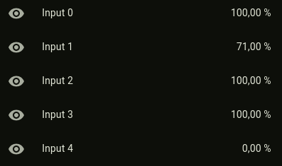

<p align="center">
  
</p>

<h1 align="center">deej-esphome</h1>

<p align="center">
  <b>A wireless hardware volume mixer for Linux.</b><br>
  Turn physical sliders on an ESPHome device into per-app volume control for PipeWire and PulseAudio, with no USB cable.
</p>

<p align="center">
  <a href="https://github.com/Random-Cow/deej-esphome/actions/workflows/ci.yml"></a>
  <a href="https://github.com/Random-Cow/deej-esphome/releases/latest"></a>
  <a href="go.mod"></a>
  <a href="LICENSE"></a>
</p>

<p align="center">
  
</p>

deej-esphome is a fork of [deej](https://github.com/omriharel/deej), the open-source hardware volume mixer. Instead of an Arduino on a serial port, it uses an **ESP32 running [ESPHome](https://esphome.io)** and receives slider positions **over WiFi in real time**. Because the controller is an ordinary ESPHome device, the same knobs can also drive lights or scenes in Home Assistant, or control several PCs at once.

## Features

- **Wireless**: the controller only needs power. deej connects to it over your network.
- **Real time**: uses ESPHome's Server-Sent Events stream (`/events`), so there's no polling and no lag.
- **Per-app volume**: map sliders to apps, groups of apps, glob patterns (`firefox*`), `master`, `mic` or `deej.unmapped` (everything else).
- **Holds its ground**: re-applies your volume when apps such as Firefox, Spotify or WirePlumber try to override it.
- **Robust connection**: reconnects automatically with backoff and detects dead WiFi links within 30 s.
- **Hot reload**: edit the config while deej is running and changes apply instantly.
- **Tray icon** showing connection status, current slider positions and active sessions.
- **Plays well with Home Assistant**: the same ESPHome device can use the native API at the same time.
- **Static binary**: no GTK/C dependencies. Runs as a systemd user service.

## Screenshots

| Tray menu on the PC | The same sliders in Home Assistant |
| :---: | :---: |
|  |  |

The display at the top is an optional extra on the controller. It shows the slider positions in ESPHome and isn't needed for deej.

## How it works

```text
 ┌────────────────────┐      WiFi / HTTP SSE       ┌────────────┐   pulse protocol   ┌──────────────────────┐
 │ ESP32 + ESPHome    │  ───────────────────────▶  │    deej    │  ───────────────▶  │ PipeWire (pipewire-  │
 │ potentiometers on  │   GET /events              │ (this app) │                    │ pulse) / PulseAudio  │
 │ ADC pins, 0–100 %  │   "Input 0" = 42           └────────────┘                    └──────────────────────┘
 └────────────────────┘
          │ native API (optional)
          ▼
   Home Assistant
```

## Quick start

### 1. Build the controller

You need an ESP32 board and up to *n* 10 kΩ linear potentiometers (sliders or knobs). Wire each pot's outer legs to **3V3** and **GND** and its wiper to an **ADC1 pin (GPIO32–GPIO39)**. ADC2 pins don't work while WiFi is on.

Flash [`esphome/deej-esphome.yaml`](esphome/deej-esphome.yaml) with ESPHome (dashboard, Home Assistant add-on or `esphome run`), after adjusting the pins to your wiring. Each sensor reports a value between 0 and 100; the sensor name `Input 0` becomes the id `input_0`.

Check that it works: `curl -N http://deej.local/events` should print `state` events while you move a slider.

Looking for enclosure ideas? The original deej project has a big [community showcase](https://github.com/omriharel/deej/blob/master/community.md).

### 2. Install deej

Download the latest archive for your architecture from [Releases](https://github.com/Random-Cow/deej-esphome/releases) and put `deej` somewhere on your `PATH`, e.g. `~/.local/bin`. You can also build it from source:

```sh
git clone https://github.com/Random-Cow/deej-esphome && cd deej-esphome
make install          # installs to ~/.local/bin and sets up the systemd user unit
```

### 3. Configure

deej reads `~/.config/deej/config.yaml`. Start from [`config.example.yaml`](config.example.yaml):

```yaml
slider_mapping:
  0: master
  1: firefox*
  2: spotify
  3:
    - discord
    - teamspeak
  4: deej.unmapped

esphome_address: deej.local   # IP, hostname or host:port

esphome_mapping:          # ESPHome sensor ids, in slider order
  - input_0
  - input_1
  - input_2
  - input_3
  - input_4

invert_sliders: false
noise_reduction: default
```

### 4. Run it

```sh
systemctl --user daemon-reload
systemctl --user enable --now deej
```

Or start `deej` directly from your desktop's autostart.

## Configuration reference

| Key | Description |
| --- | --- |
| `slider_mapping` | Map of slider index (starting at 0) to one target or a list of targets. Targets are process names (case-insensitive, globs like `chrom*` allowed), `master`, `mic` or `deej.unmapped`. |
| `esphome_address` | Address of the ESPHome device: IP, hostname (`deej.local` via mDNS) or `host:port`. Changes apply without a restart. Older configs using `esphome_ip` keep working. |
| `esphome_mapping` | ESPHome sensor ids in slider order. The id is the sensor name in lowercase with underscores (`Input 0` → `input_0`). Legacy and current ESPHome id formats are both supported. |
| `invert_sliders` | `true` if 100 % should be at the bottom. |
| `noise_reduction` | `low`, `default` or `high`. Raise it if volumes jitter. |

## Troubleshooting

- **Logs**: `journalctl --user -u deej -f`, or `~/.local/state/deej/deej-latest-run.log`. Run `deej -v` in a terminal for verbose output.
- **Not connecting**: run `curl -N http://<esphome_address>/events`. If that fails, check `web_server:` in your ESPHome config and the device's address.
- **A slider does nothing**: compare the sensor ids from the `curl` output with `esphome_mapping`.
- **Volume only reaches part of the range**: the firmware must report 0–100. Use the filter chain from the example YAML (older examples scaled to 0–1023).
- **App not found**: the tray menu shows active sessions. Use the process name as reported by PipeWire, or a glob.

## Credits

deej-esphome stands on the shoulders of:

- [**deej**](https://github.com/omriharel/deej) by Omri Harel: the original project, design and most of the code.
- **Severin**: Linux/PulseAudio support in upstream deej.
- **Peter Ernst**: PipeWire fix.
- **Cristian Zănescu**: libayatana / Linux Mint compatibility.
- The author of the first ESPHome REST port of deej, which this fork grew from.

This project is an independent fork. It is **not affiliated with or endorsed by** the original deej project.

## License

[MIT](LICENSE). Release archives include the licenses of all bundled third-party Go modules.
